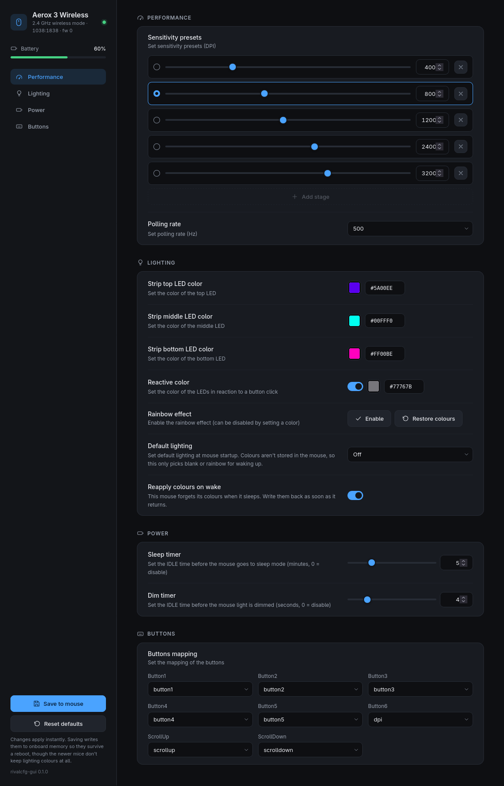

<h1 align="center">Steely Mouse</h1>
<p align="center">
<i>A web GUI for configuring SteelSeries mice, built on <a href="https://github.com/flozz/rivalcfg"><code>rivalcfg</code></a></i>
<br />

</p>

<details>
  <summary>Contents</summary>

- [About](#about)
- [Install](#install)
- [Usage](#usage)
- [Configuration](#configuration)
- [Development](#development)
- [Credits](#credits)

</details>

## About

Change your mouse's DPI stages, polling rate, lighting (gradients too), button mapping and sleep timers from a browser tab. It runs on your own machine and talks to the mouse over USB through rivalcfg, so it works with any mouse rivalcfg supports.

There's nothing hardcoded per mouse. The controls are drawn from each device's rivalcfg profile, so a newly supported mouse usually just works.

<p align="center">

</p>

---

## Install

> [!NOTE]
> On Linux, the mouse belongs to root until its udev rules are installed. If they're missing, the app tells you and gives you the exact command to run, once (NixOS is different, see below). macOS and Windows need no setup.

### Download

Grab the binary for your system from the [latest release](https://github.com/NotAFlightRisk/steely-mouse/releases/latest), make it executable and run it.

```bash
chmod +x rivalcfg-gui-1.0.0-linux-x86_64
./rivalcfg-gui-1.0.0-linux-x86_64
```

There's one for Linux and macOS on both Intel and ARM, and one for Windows. Python and the device profiles are baked in, so there's nothing else to install. Each release also has a `SHA256SUMS` and a build provenance attestation, if you want to check what you downloaded.

macOS will refuse to open it the first time, as it isn't signed. Run `xattr -d com.apple.quarantine rivalcfg-gui-*` and try again.

### Nix

```bash
nix run github:NotAFlightRisk/steely-mouse
```

You'll still need the udev rules from somewhere, so use the module below or add `services.udev.packages = [ pkgs.rivalcfg ];` yourself.

### NixOS

```nix
inputs.steely-mouse.url = "github:NotAFlightRisk/steely-mouse";

imports = [ inputs.steely-mouse.nixosModules.default ];
programs.rivalcfg-gui.enable = true;
users.users.<your-username>.extraGroups = [ "input" ];
```

That installs the app and the udev rules together. Rebuild, then log out and back in for the group change to apply. Writing the rules file by hand won't work here, as `/etc/udev/rules.d` is read only.

### pip

```bash
pipx install git+https://github.com/NotAFlightRisk/steely-mouse
rivalcfg-gui
```

Plain `pip install` or `uv tool install` take the same URL. You'll need Python 3.10 or newer.

### Docker

```bash
docker run --rm -p 127.0.0.1:8777:8777 --device /dev/hidraw0 notaflightrisk/steely-mouse
```

Then open [localhost:8777](http://localhost:8777). The hidraw number moves around between reboots, so check `ls -l /dev/hidraw*` first. There's a [`docker/compose.yml`](https://github.com/NotAFlightRisk/steely-mouse/blob/main/docker/compose.yml) if you'd rather not retype that every time.

The image carries the udev rules too, so you can install them without putting rivalcfg on the host:

```bash
docker run --rm --entrypoint cat notaflightrisk/steely-mouse \
  /udev/99-steelseries-rival.rules | sudo tee /etc/udev/rules.d/99-steelseries-rival.rules
```

### Build from source

```bash
git clone git@github.com:NotAFlightRisk/steely-mouse.git
cd steely-mouse
pip install .
rivalcfg-gui
```

<details>
<summary>Not sure which to pick?</summary>

- The download is the least fuss, no Python or package manager needed
- On NixOS, use the module, it's the only one that sorts the permissions out for you
- `pipx` is the tidiest option everywhere else, as it keeps it out of your system Python
- Docker works, but passing USB devices into a container is more hassle than it saves here
- Build from source if you're changing the code, or there's no `hidapi` wheel for your platform

</details>

---

## Usage

Run `rivalcfg-gui` and it'll open [localhost:8777](http://localhost:8777) in your browser.

Changes apply as soon as you make them. "Save to mouse" writes them to onboard memory so they survive a reboot, though some of the newer mice (Aerox, Prime, Rival 5 and friends) forget their colours whenever they nod off. Those get a "Reapply colours on wake" switch.

No mouse to hand? `rivalcfg-gui --demo` runs against a fake one and touches no hardware. Pass an id like `--demo 1038:1702` to see what a different mouse would look like.

---

## Configuration

| Flag | Environment | Default | What it does |
|---|---|---|---|
| `--host` | `RIVALCFG_GUI_HOST` | `127.0.0.1` | Address to bind |
| `--port` | `RIVALCFG_GUI_PORT` | `8777` | Port to listen on |
| `--log-level` | `RIVALCFG_GUI_LOG_LEVEL` | `info` | `debug` adds request logs and tracebacks |
| `--no-browser` | | off | Don't open a browser on start |
| `--print-udev` | | | Print the Linux udev rules and exit |
| `--demo [VID:PID]` | | off | Fake device, touches no hardware |

Flags win over the environment, which wins over the defaults. Anyone who can reach the port can retune your mouse, so keep it on loopback unless you really mean it.

---

## Development

```bash
git clone git@github.com:NotAFlightRisk/steely-mouse.git
cd steely-mouse
pip install -e . pytest ruff
python -m rivalcfg_gui --demo
```

Then `pytest -q` for the tests and `ruff check .` for the lint. On Nix, `nix develop` drops you in a shell with the dependencies and pytest instead of the `pip install`.

`schema.py` turns rivalcfg's device profiles into plain descriptions (labels, value types, ranges and defaults), and the frontend draws its controls from those. The one setting with no proper widget is per-axis DPI, which falls back to a text box.

---

## Credits

##### Contributors

[](https://github.com/NotAFlightRisk/steely-mouse/graphs/contributors)

---

<!-- License + Copyright -->
<p  align="center">
  <a href="https://github.com/NotAFlightRisk"></a><br>
  <sup>
    <i>Licensed under <a href="https://github.com/NotAFlightRisk/steely-mouse/blob/main/LICENSE">MIT</a>, © <a href="https://peng.ly">NotAFlightRisk</a> 2026</i>
  </sup>
</p>

<!--
oooh, hello there! hope you're having a nice day :)
   |\__      |\___
 (:> __)X  (:o ___(
   |/        |/
-->
